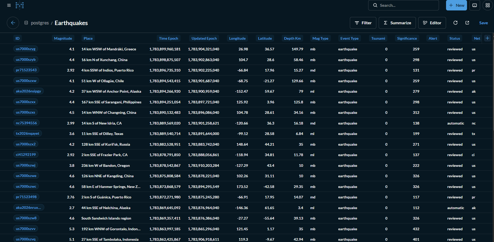

# data-engineer-earthquake-pipeline

A daily ELT pipeline for earthquake data. An Airflow DAG fetches events of magnitude 2.5 and
above from the USGS Earthquake Catalog API, upserts them into PostgreSQL, builds staging,
intermediate and mart models with dbt, and runs dbt tests against the result. Metabase is
included in the Docker Compose stack for browsing the tables.

Loads are idempotent: each run upserts on the USGS event id, so Airflow retries and backfills
update rows instead of duplicating them. The magnitude, depth and region rules are dbt macros, so
singular dbt tests can check them on literal values: either side of each magnitude and depth
threshold, and sample place strings. CI runs the
loader's unit tests, then `dbt run` and `dbt test` against fixed seed rows in a Postgres service
container, without calling USGS.

The dbt docs site, with the model lineage graph, is published to GitHub Pages:
https://calemccammon.github.io/data-engineer-earthquake-pipeline/



## Running it

The only prerequisite is Docker with Compose.

```bash
git clone https://github.com/calemccammon/data-engineer-earthquake-pipeline.git
cd data-engineer-earthquake-pipeline
cp .env.example .env
docker compose up --build -d
```

`docker-compose.yml` reads `POSTGRES_PASSWORD` and `AIRFLOW_SECRET_KEY` from `.env`. The Airflow
login is fixed at `admin` / `admin` in the Compose file.

Once the `airflow` container is healthy, the services are available at:

| Service | Address | Login |
|---|---|---|
| Airflow UI | http://localhost:8080 | `admin` / `admin` |
| Metabase | http://localhost:3000 | setup wizard on first visit |
| PostgreSQL | `localhost:5432`, database `earthquake_dw` | `postgres` / value of `POSTGRES_PASSWORD` (default `postgres`) |

Metabase is not preconfigured with a data source. In its setup wizard, add a PostgreSQL
database with host `postgres`, port `5432`, database `earthquake_dw` and the credentials above.

### Triggering a run

In the Airflow UI, unpause the `earthquake_pipeline` DAG and trigger it. The tasks run in the
order `fetch_and_load → dbt_run → dbt_test`. The fetch covers the run's data interval
(`data_interval_start` to `data_interval_end`).

The DAG has `catchup=False`, so past days are not loaded automatically. To load a historical
range, use the Airflow CLI:

```bash
docker compose exec airflow airflow dags backfill earthquake_pipeline \
  --start-date 2024-01-01 --end-date 2024-01-31 --reset-dagruns
```

### Querying the marts

```bash
docker compose exec postgres psql -U postgres -d earthquake_dw
```

```sql
-- Regions with the most earthquakes
SELECT region, total_earthquakes, avg_magnitude, major_plus_count
FROM marts.mart_regional_stats
ORDER BY total_earthquakes DESC
LIMIT 20;

-- Daily counts of magnitude 6.0 and above
SELECT occurred_date, magnitude_class, earthquake_count
FROM marts.mart_daily_counts
WHERE magnitude_class IN ('strong', 'major', 'great')
ORDER BY occurred_date DESC;
```

### Generating the dbt docs locally

With `dbt-postgres` installed and the Compose Postgres running:

```bash
cd earthquake_dbt
dbt docs generate --profiles-dir .
dbt docs serve --profiles-dir . --port 8081
```

`dbt docs serve` defaults to port 8080, which the Airflow UI already uses, so the command above
picks another port.

## How it works

```
USGS Earthquake Catalog API  (GeoJSON, no API key)
         │
         │  Airflow DAG: earthquake_pipeline (@daily, 2 retries, 5 minutes apart)
         ▼
┌─────────────────────┐
│  fetch_and_load     │  Python task. Requests events with magnitude >= 2.5 for the
│                     │  run's data interval and upserts them into raw.earthquakes.
└────────┬────────────┘
         ▼
┌─────────────────────┐
│  PostgreSQL 16      │  raw.earthquakes, one row per USGS event id
└────────┬────────────┘
         │  dbt_run   (BashOperator: dbt run)
         ▼
┌───────────────────────────────────────────────────┐
│  staging.stg_earthquakes                 (view)   │
│  intermediate.int_earthquakes_classified (view)   │
│  marts.fact_earthquakes                  (table)  │
│  marts.mart_daily_counts                 (table)  │
│  marts.mart_regional_stats               (table)  │
└────────┬──────────────────────────────────────────┘
         │  dbt_test  (BashOperator: dbt test)
         ▼
┌─────────────────────┐
│  Metabase           │  localhost:3000, pointed at earthquake_dw by hand
└─────────────────────┘
```

The stack is four Compose services: `postgres` (PostgreSQL 16), `airflow-init` (migrates the
Airflow metadata database and creates the admin user), `airflow` (webserver and scheduler in one
container, LocalExecutor) and `metabase`. The Airflow image is `apache/airflow:2.10.0-python3.12`
with `dbt-postgres==1.9.0`, `psycopg2-binary` and `requests` installed on top. One Postgres
instance holds three databases: `earthquake_dw` for the data, `airflow` for Airflow metadata and
`metabase` for Metabase's application state.

### Load

`scripts/fetch_earthquakes.py` makes one request to
`https://earthquake.usgs.gov/fdsnws/event/1/query` with `format=geojson`, the interval's start
and end times, `minmagnitude=2.5` and `limit=20000`. Each GeoJSON feature is flattened into a
row and written with a single `INSERT ... ON CONFLICT (id) DO UPDATE` statement that overwrites
every column and sets `loaded_at` to the current time.

The loader stores every event type the API returns. Filtering to earthquakes happens in the
staging model.

`raw.earthquakes` is created by `scripts/init.sql` when the Postgres volume is first
initialised. Its columns:

| Column | Description |
|---|---|
| `id` | USGS event id, primary key |
| `magnitude` | Event magnitude |
| `place` | Location text, for example "15km NW of Parkfield, California" |
| `time_epoch`, `updated_epoch` | Origin time and last update time, Unix milliseconds |
| `longitude`, `latitude`, `depth_km` | Hypocentre coordinates |
| `mag_type` | Magnitude scale (mw, ml, md, mb and others) |
| `event_type` | USGS event type (earthquake, quarry blast, explosion and others) |
| `tsunami` | 1 if a tsunami message was issued |
| `significance` | USGS significance score |
| `alert` | PAGER alert level, if one was issued |
| `status`, `net`, `nst`, `dmin`, `rms`, `gap`, `title` | Review status, network and solution quality fields, passed through |
| `loaded_at` | When the row was last written by the loader |

### dbt models

```
source raw.earthquakes
  └── stg_earthquakes
        └── int_earthquakes_classified
              └── fact_earthquakes
                    ├── mart_daily_counts
                    └── mart_regional_stats
```

| Model | Schema | Materialisation | What it does |
|---|---|---|---|
| `stg_earthquakes` | `staging` | view | Keeps rows where `event_type` is `earthquake` and magnitude and time are present. Converts epoch milliseconds to UTC timestamps, lower-cases `mag_type`, `event_type` and `status`, turns `tsunami` into a boolean `is_tsunami_related`, and renames `nst`, `dmin` and `gap`. |
| `int_earthquakes_classified` | `intermediate` | view | Adds `magnitude_class`, `depth_class`, `region`, `occurred_date` and `occurred_hour`. |
| `fact_earthquakes` | `marts` | table | All columns of the intermediate model, one row per event. |
| `mart_daily_counts` | `marts` | table | Per day and magnitude class: event count, average, minimum and maximum magnitude, average depth, tsunami count. |
| `mart_regional_stats` | `marts` | table | Per region: event count, average and maximum magnitude, average depth, count of `major` and `great` events (magnitude 7.0 and above), tsunami count, active days, first and latest event time. |

The classification rules in `int_earthquakes_classified` are macros in
`earthquake_dbt/macros/classify.sql`:

| Column | Rule |
|---|---|
| `magnitude_class` | below 4.0 `minor`, below 5.0 `light`, below 6.0 `moderate`, below 7.0 `strong`, below 8.0 `major`, otherwise `great` |
| `depth_class` | below 70 km `shallow`, below 300 km `intermediate`, otherwise `deep`. `unknown` when USGS reports no depth. |
| `region` | The text after the last comma in `place`, or the whole string when there is no comma. `Unknown` when `place` is missing or blank. |

## Design decisions

- **Upsert on the USGS event id.** Airflow retries and backfills run the same interval more
  than once. Keying the load on `id` with `ON CONFLICT DO UPDATE` makes a re-run replace rows
  instead of adding them, and picks up any fields USGS has changed since the previous load.
- **Event-type filtering in dbt, not in the loader.** The raw table keeps what the API returned.
  `stg_earthquakes` drops quarry blasts, explosions and other non-earthquake events, and an
  `accepted_values` test on `event_type` checks the result.
- **Schema names without the target prefix.** By default dbt would name the schemas
  `analytics_staging`, `analytics_intermediate` and `analytics_marts`. The
  `generate_schema_name` macro overrides this so the layers land in `staging`, `intermediate`
  and `marts`.
- **Views for staging and intermediate, tables for marts.** Only the models that Metabase and
  ad hoc queries read are materialised.
- **Metabase state in Postgres.** Metabase is configured to keep its application database in the
  `metabase` Postgres database instead of its default embedded H2 file.
- **Classification rules as macros.** The magnitude, depth and region expressions are macros so
  that the singular tests can call the same code on literal boundary values.
- **CI runs against seed rows.** The workflows load a small set of fixed rows from
  `scripts/seed_test_data.sql` into a Postgres service container, so CI does not call the USGS
  API. `scripts/init_ci.sql` creates the raw table without the Airflow and Metabase databases.

## Testing

There are two kinds of tests, and the `dbt Tests` workflow runs both on every push and pull
request to `main`.

**Python unit tests.** `tests/test_fetch_earthquakes.py` covers the loader:
field mapping and missing-value handling in `parse_feature`, the request parameters and error
propagation in `fetch_earthquakes`, the generated upsert statement and its values in
`upsert_earthquakes`, and the closing of the connection in `run`. HTTP and database calls are
mocked, so no services are needed:

```bash
pip install pytest requests psycopg2-binary
pytest tests/
```

These tests check the text of the upsert statement. They do not execute it against a database.

**dbt tests.** Generic tests (`not_null`, `unique`, `accepted_values`) are declared in the
`schema.yml` and `sources.yml` files, and singular tests are in `earthquake_dbt/tests/`:

| Test | Fails when |
|---|---|
| `assert_no_future_timestamps` | `occurred_at` is more than one hour in the future |
| `assert_valid_magnitude_range` | magnitude is below -2 or above 10 |
| `assert_magnitude_class_boundaries` | the `magnitude_class` macro returns the wrong class for a literal value on either side of a threshold (3.99 and 4.0, 7.99 and 8.0, and so on) |
| `assert_depth_class_boundaries` | the `depth_class` macro returns the wrong class at 69.9, 70, 299.9 or 300 km, or for a missing depth |
| `assert_region_from_place` | the `region_from_place` macro returns the wrong region for a literal place string, including an empty and a null one |

In the DAG, a failing dbt test fails the `dbt_test` task and so the run. In CI the same tests
run against the seed rows, one of which has no `place`.

A second workflow, `Deploy dbt Docs`, rebuilds the docs site and deploys it to GitHub Pages when
a push to `main` changes `earthquake_dbt/` or the workflow file. To use it in a fork, set
**Settings → Pages → Source** to **GitHub Actions**.

## Limitations

- The stack is a local development setup. Credentials are defaults, the Airflow webserver and
  scheduler share one container, and the Metabase image tag is `latest`.
- Every run rebuilds the three mart tables in full. No model is incremental.
- The fetch is a single request capped at 20,000 events with no pagination. A daily interval is
  far below the cap, but a long interval passed to the script directly could be truncated.
- A run only fetches events whose origin time falls in its interval. Revisions that USGS makes
  to an event later are picked up only if that interval is run again.
- `region` is a string split, so the same area can appear under more than one name
  ("California" and "CA"), and places with no comma become their own region.
- CI installs dbt without a version pin, so it can run a newer dbt than the 1.9.0 pinned in the
  Airflow image.
- Metabase ships without a data source, saved questions or dashboards. They have to be created
  by hand.

## Data source

Event data comes from the
[USGS Earthquake Catalog API](https://earthquake.usgs.gov/fdsnws/event/1/), which needs no API
key.
